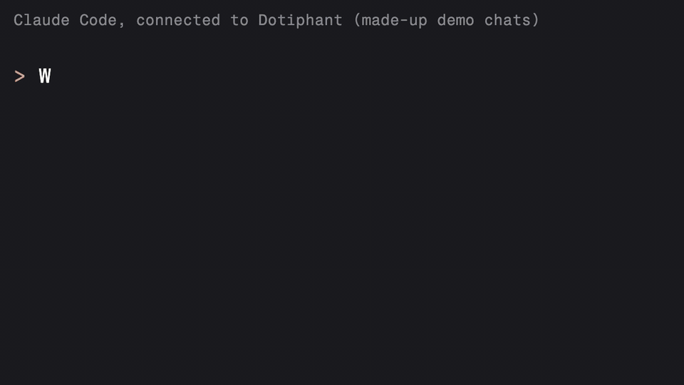
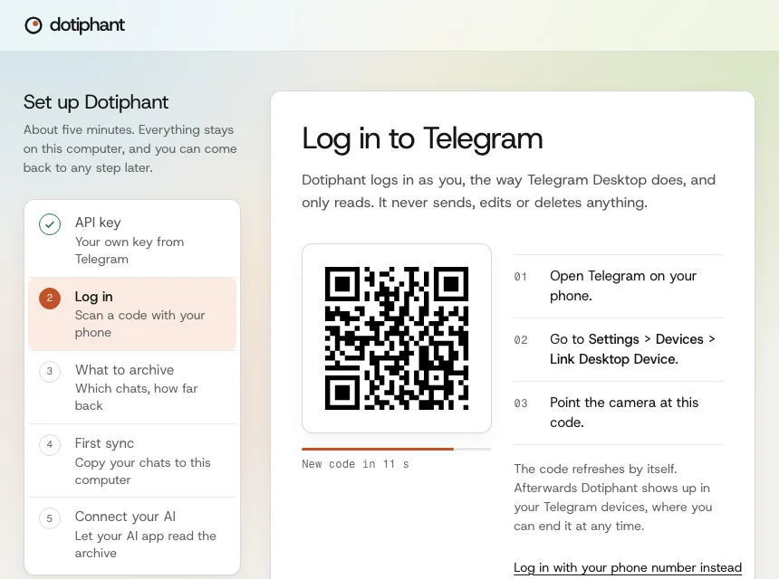

# Dotiphant

Your Telegram chats, searchable on your own computer and readable by your AI assistant.

AI assistants can't read your Telegram. Bots only see messages sent after they join, never the history. Cloud CRMs that sync Telegram want your account on their servers. Dotiphant logs in as you, copies your chats into a single file on your own computer, and lets your AI assistant read that file when you ask it to.



## What you get

- The full history of your chats with people and groups, including forum topics and groups that were upgraded to supergroups. Channels are optional.
- A local viewer in your browser with fast full-text search, media, and "copy as Markdown" for any chat or time range.
- An MCP server, so Claude Desktop, Claude Code, Codex and Cursor can search and read your archive. ChatGPT, claude.ai and other apps that support remote MCP servers can connect through the optional HTTP mode behind a tunnel you run (see [docs/remote-access.md](https://github.com/Zierold-Ventures/dotiphant/blob/main/docs/remote-access.md)).
- Markdown export on the command line, ready to pipe into any AI tool.
- Read-only toward Telegram: Dotiphant never sends, edits, deletes or marks anything as read.
- Your Telegram session and API keys stay in the system keychain. The archive is a SQLite file in a private folder.
- Background refresh every 15 minutes, if you want it.

## Quick start

On macOS or Linux, paste this into a terminal:

```sh
curl -fsSL https://dotiphant.com/install.sh | sh
```

The script is about 150 lines; [read it first](https://github.com/Zierold-Ventures/dotiphant/blob/main/install.sh). It installs [uv](https://docs.astral.sh/uv/) if needed (uv brings its own Python), installs the latest Dotiphant release from GitHub, and runs `dotiphant open`. To update, run it again; it also stops a viewer that still runs the old version.

The installer checks the download against the release's SHA-256 checksums and stops on a mismatch. To check a release yourself, see [Verify a download](https://github.com/Zierold-Ventures/dotiphant/blob/main/docs/security.md#verify-a-download).

Dotiphant ships as [GitHub releases](https://github.com/Zierold-Ventures/dotiphant/releases), not on PyPI. Other ways, if you already have uv:

| Goal | Command |
| --- | --- |
| Install a release | `uv tool install <URL of the .whl file on the release page>`, then `dotiphant open` |
| From a local clone | `uv tool install .` |
| Update | `uv tool install --upgrade <URL of the new .whl file> && dotiphant stop` |

The command is `dotiphant`; `phant` is a short alias.

`dotiphant open` walks you through setup in your browser in about 5 minutes. `dotiphant setup` does the same in the terminal. Both are safe to run again:

1. Create your own Telegram API id and hash at [my.telegram.org](https://my.telegram.org) (free, about a minute).
2. Log in by scanning a QR code with the Telegram app (Settings > Devices > Link Desktop Device). Phone login works too.
3. Choose what to archive: people and groups by default, the last 365 days or everything.
4. Run the first sync.
5. Connect the AI apps it finds on your computer, and turn on background refresh.



Afterwards:

```sh
dotiphant open                     # browse and search in your browser
dotiphant connect claude-desktop   # or claude-code, codex, cursor
```

Not comfortable with a terminal? Give [docs/install-with-ai.md](https://github.com/Zierold-Ventures/dotiphant/blob/main/docs/install-with-ai.md) to Claude Code, Codex or another AI assistant that can run commands, and it will install Dotiphant with you.

## Try it without Telegram

```sh
dotiphant demo
```

This opens the viewer on made-up chats, stored apart from your real data. No login needed. It uses port 8764, so it can run next to `dotiphant open`.

## Things to ask your AI assistant

- "What did Clara and I agree on about the launch date?"
- "Summarize what happened in my groups since yesterday."
- "Which messages do I still owe an answer to this week?"
- "Find the wallet address someone sent me in the Acme group."
- "Draft a reply to Wendell based on our last conversation." (Dotiphant never sends it; you do.)

## Commands

| Command | What it does |
| --- | --- |
| `dotiphant open` | Open the viewer at http://127.0.0.1:8765, with setup on first run. `dotiphant serve` does the same |
| `dotiphant setup` | The same guided setup in the terminal. Safe to re-run; finished steps are skipped |
| `dotiphant sync [CHAT ...]` | Fetch new messages now, for all chats or the ones named. A named chat also gets edits to its recent messages. Sync also keeps each chat's profile photo. Exits with 3 when some chats could not be read (they are retried next time), 2 when not logged in or the archive belongs to another account |
| `dotiphant avatars [CHAT ...]` | Fetch new or changed chat profile photos without a full sync. `--refresh` downloads them all again |
| `dotiphant status` | Login, archive size, last sync, background refresh |
| `dotiphant doctor` | Check the installation and print fixes |
| `dotiphant connect [APP]` | Connect an AI app to your archive, or list the apps it can connect |
| `dotiphant chats` | List archived chats |
| `dotiphant search QUERY` | Full-text search, with `--chat`, `--since`, `--json` |
| `dotiphant export CHAT` | Print a chat as Markdown, `--since 7d`, `--out FILE` |
| `dotiphant recent` | What happened in the last 24 hours |
| `dotiphant media CHAT` | Download photos, files and voice notes of a chat |
| `dotiphant schedule install` | Refresh in the background every N minutes |
| `dotiphant mcp` | The MCP server (AI apps start this themselves) |
| `dotiphant mcp --http --public-url URL` | Remote access for ChatGPT, claude.ai and other remote MCP apps: [docs/remote-access.md](https://github.com/Zierold-Ventures/dotiphant/blob/main/docs/remote-access.md) |
| `dotiphant import PATH` | Add a Telegram Desktop JSON export (`result.json`), or a chat from WhatsApp's own "Export chat" (.zip or .txt), to the archive. Experimental. Nothing connects to WhatsApp. See [docs/faq.md](https://github.com/Zierold-Ventures/dotiphant/blob/main/docs/faq.md) |
| `dotiphant ai` | Show which chats AI apps may read. `dotiphant ai hide CHAT` and `dotiphant ai show CHAT` change one chat; `dotiphant ai mode selected` lets AI apps read only the chats you allow |
| `dotiphant forget CHAT` | Delete a chat and its media from the archive, and stop syncing it |
| `dotiphant demo` | Try the viewer with made-up chats |
| `dotiphant stop` | Stop a running viewer and the demo viewer, for example after an update |
| `dotiphant login` / `dotiphant logout` | Log in again, or end the session |

CHAT can be a chat id, an `@username` or part of the title. Run `dotiphant COMMAND --help` for all options.

```sh
dotiphant export "Acme" --since 7d | claude -p "What are the open action items?"
```

## Privacy and safety

- Everything stays on your computer. Dotiphant has no cloud service and sends no telemetry.
- Dotiphant only reads from Telegram, and paces its requests, and waits whenever Telegram asks it to slow down.
- The viewer listens on 127.0.0.1 only. The MCP server talks to AI apps over stdio and opens no port.
- The optional HTTP MCP server listens on 127.0.0.1 and needs a bearer token or an app you approved with a one-time pairing code. With `--host ADDRESS --allow-remote` it listens on that address instead, and other machines can reach it. Remote access through a tunnel: [docs/remote-access.md](https://github.com/Zierold-Ventures/dotiphant/blob/main/docs/remote-access.md).
- Message text handed to an AI is marked as untrusted, and the AI is told never to follow instructions found in messages. This lowers the risk of prompt injection; no tool can rule it out.
- When you ask an AI app a question, the messages it reads go to that app's provider, the same as anything else you paste into it.
- You choose which chats AI apps may read. Hide single chats, or allow only the chats you pick, with `dotiphant ai` or the "Visible to AI apps" switch on a chat's page. Hidden chats are never listed, searched or read by AI apps. The viewer and the CLI still show every chat.
- The stored session gives full access to your Telegram account. Protect your computer like you protect your phone.
- Dotiphant never uses your messages to train AI models.

Details, and how to wipe everything: [docs/security.md](https://github.com/Zierold-Ventures/dotiphant/blob/main/docs/security.md). What data exists and who receives it: [docs/privacy.md](https://github.com/Zierold-Ventures/dotiphant/blob/main/docs/privacy.md). Common questions: [docs/faq.md](https://github.com/Zierold-Ventures/dotiphant/blob/main/docs/faq.md).

## Not affiliated with Telegram

Dotiphant is an independent, unofficial app that uses the Telegram API. It is not made, endorsed or supported by Telegram. It uses the public Telegram API with your own API credentials, and you are responsible for using it within the [Telegram API Terms of Service](https://core.telegram.org/api/terms). Using Telegram data with AI apps is also subject to Telegram's [Terms for Content Licensing and AI Scraping](https://telegram.org/tos/content-licensing). Check both before you connect an AI app.

## Use at your own risk

Dotiphant is built with care, on a best-effort basis. Use it at your own risk. It comes without any warranty, and its authors accept no liability for damage or loss, as set out in the MIT license.

## License

MIT

<!-- mcp-name: io.github.Zierold-Ventures/dotiphant -->
